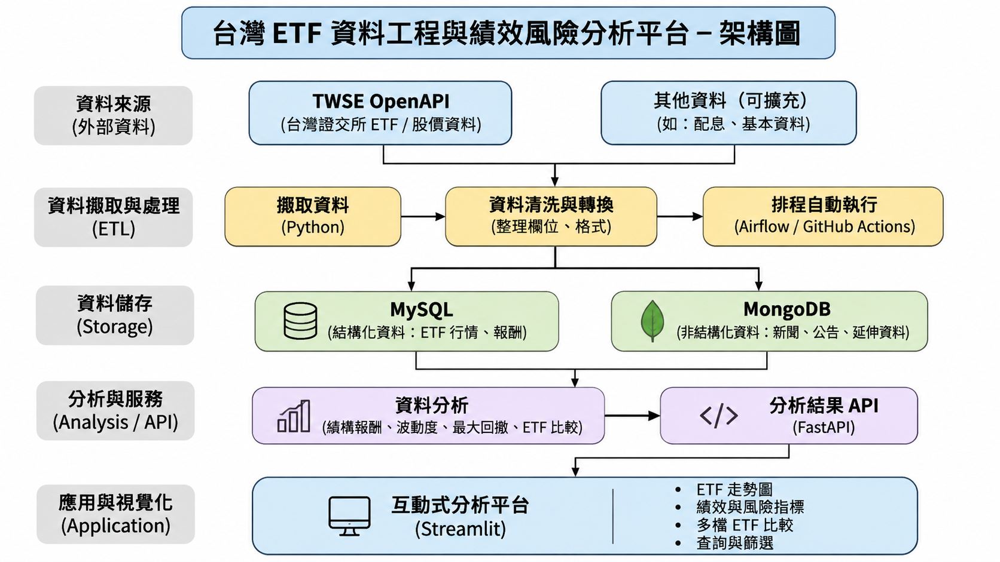

[Readme.md](https://github.com/user-attachments/files/34511854/Readme.md)
# de-01-project# 台灣 ETF 資料工程與績效風險分析

**報告人：** 汪宏彥  
**報告日期：** 2026/11/01

## 目錄

1. [製作動機與業務問題](#1-製作動機與業務問題)
2. [確認至少一項資料來源能取得（Input）](#2-確認至少一項資料來源能取得input)
3. [資料來源的取得方式](#3-資料來源的取得方式)
4. [資料來源的欄位和格式](#4-資料來源的欄位和格式)
5. [預期產出（Output）](#5-預期產出output)
6. [初步的技術堆疊與可行性](#6-初步的技術堆疊與可行性)
7. [流程圖或 Pipeline 規劃](#7-流程圖或-pipeline-規劃)
8. [預期風險與每週進度](#8-預期風險與每週進度)

## 1. 製作動機與業務問題

1. 專題旨在打造一套針對台股 ETF 的資料擷取、技術分析與回測模擬平台。
2. 解決新手投資人對「台股 ETF」與「一次投入績效表現」的疑問。
3. 整合 上的 ETF 上市標的，並透過技術指標進行策略回測與績效評估，協助使用者快速了解特定投資策略在不同 ETF 上的長期報酬率、風險指標與勝率表現，作為制定投資決策的參考依據，並每日推薦前 10 隻 ETF。

## 2. 確認至少一項資料來源能取得（Input）

### 2.1 臺灣證券交易所（TWSE）— 主要資料來源

- ETF 基本資料：代號、名稱、上市日期及標的指數。
- ETF 資訊：資產規模、收盤價及成交資訊。
- 取得方式：透過官方網站查詢及 CSV 下載。

### 2.2 證券櫃檯買賣中心（TPEx）— 補充資料來源

- 上櫃 ETF 基本資訊及歷史行情。
- 支援日、週、月、年行情查詢。
- 取得方式：透過官方網站查詢及 CSV 下載。

### 2.3 Yahoo 股市 — 輔助資料來源

- ETF 歷史價格及市場行情。
- 作為行情資料的補充與交叉比對來源。
- 取得方式：評估網頁資料或可用的資料介接方式，並確認使用條款及資料穩定性。

### 資料取得規劃

1. 初期選擇 5～10 檔台灣 ETF 作為測試標的。
2. 優先使用交易所及櫃買中心的官方公開資料。
3. 確認資料欄位、檔案格式及更新頻率。
4. 將取得的原始資料匯入 Python，進行清理與格式轉換。
5. 將整理後的資料儲存至 MySQL 資料庫。

## 3. 資料來源的取得方式

**開發工具（簡報所列）：** PyCharm、Visual Studio Code  
**資料取得方式（簡報所列）：** 爬蟲、CSV、API、網頁資料

資料處理流程：

1. **資料來源：** TWSE／TPEx／其他可用資料來源。
2. **Python 資料取得：** CSV／API／網頁資料。
3. **pandas 資料清洗：** 缺失值、重複資料、欄位格式整理。
4. **MySQL 資料儲存：** 儲存整理後的 ETF 資料。

## 4. 資料來源的欄位和格式

1. **ETF 基本資料：** ETF 代號、ETF 名稱、投信公司、追蹤指數。
2. **歷史行情資料：** 交易日期、開盤價、最高價、最低價、收盤價、成交量。
3. **績效分析欄位：** 每日報酬率、累積報酬率、波動率、最大回撤。
4. **資料格式：** 原始資料以網站表格、CSV 或 API 回傳格式取得，再整理成統一欄位。
5. **儲存方式：** 使用 Python（pandas）清理資料，並將整理後的資料存入 MySQL 資料表。
6. **資料檢查：** 確認日期與數值格式正確，並檢查缺漏值及重複資料。

## 5. 預期產出（Output）

1. **ETF 歷史行情資料庫：** 集中保存 ETF 基本資料與歷史價格。
2. **自動化資料處理流程（ETL）：** 完成資料擷取、清理、轉換及載入 MySQL。
3. **ETF 績效與風險分析：** 計算期間報酬率、波動率及最大回撤，供不同 ETF 比較。
4. **視覺化儀表板：** 以圖表呈現 ETF 價格走勢、績效與風險指標。
5. **資料品質檢查與執行紀錄：** 整理缺漏、重複資料及更新結果，方便追蹤問題。
6. **專題成果文件：** 提供程式碼、資料表設計、操作說明及分析結果。

## 6. 初步的技術堆疊與可行性

> 待補充：原始簡報第 8 頁只有章節標題，尚無細節內容。

## 7. 流程圖或 Pipeline 規劃

> 待補充：原始簡報目錄有此章節，但沒有對應的內容頁。

## 8. 預期風險與每週進度

> 待補充：原始簡報第 9 頁只有章節標題，尚無細節內容。

---

*本 README 依「台灣 ETF 資料工程與績效風險分析3.pptx」轉寫為 Markdown，保留原簡報的規劃內容；未填寫的部分標記為「待補充」，並不代表相關功能已完成。*
## 系統架構圖

